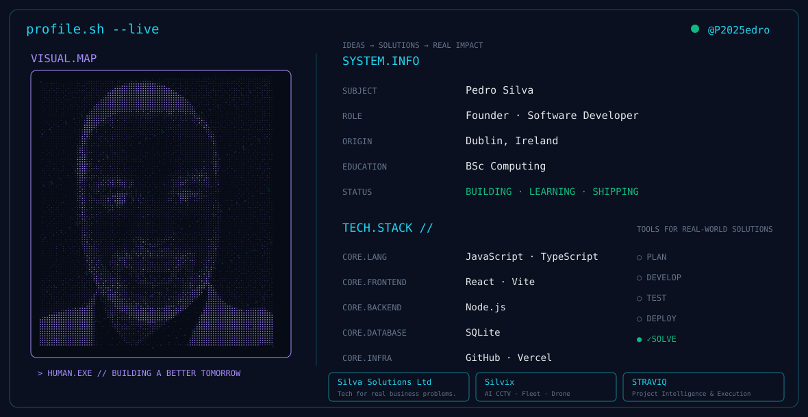

  

# Pedro Silva
### Founder of Silva Solutions Ltd · Software Developer

**Dublin, Ireland · BSc in Computing**

Building practical software and AI solutions for real business problems.

---

## TECH.STACK

  
  
  
  
  
  
  
  

## PROJECTS

| Project | What it does |
|---|---|
| **[Silva Solutions Ltd](https://silvasolutions.ie)** | IT support, software and AI solutions for Irish businesses. |
| **Silvix** | AI-powered CCTV monitoring, incidents and fleet tracking. |
| **STRAVIQ** | Project intelligence and execution platform. |
| **Silva Signage Network** | Indoor digital advertising network on Smart TVs in Dublin businesses. |
| **Silva Studio** | AI video production studio. |

**Client websites:** barbershops, restaurants, food trucks, grocery stores and community spaces across Dublin — designed, built and deployed on Vercel.

---

## GITHUB.STATS

  
  

## CONTRIBUTION.ACTIVITY

---

`> const future = better();`

**DISCIPLINE TODAY. BIGGER TOMORROW.**

